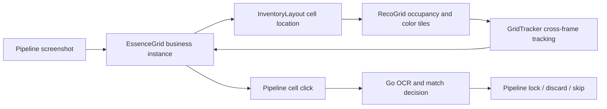

# RecoGrid / GridTracker / EssenceGrid Architecture

Essence inventory scanning is composed of three C++ modules that can each be understood on their own, instead of one monolithic engine that owns recognition, tracking, and business flow:



## Module boundaries

| Module | Owns | Does not own |
| --- | --- | --- |
| `RecoGrid` | Project supplied cell rectangles, evaluate occupancy, and generate alignment tiles | Cell location, frame history, scroll order, business quality, clicks |
| `GridTracker` | Adjacent-frame alignment, global row/column indices, deduplication, order, and end confirmation | Image segmentation, template loading, Pipeline routing |
| `EssenceGrid` | Essence quality, lock/discard thumbnails, pending queue, and Maa callbacks | Skill OCR, match rules, actual UI actions |
| Go `essencefilter` | Scan-result routing, detail-read counts, OCR normalization, target combination matching, Lock/Discard/Skip decisions | Grid recognition and button clicks |
| Pipeline | Screenshot timing, clicks, swipes, waits, and post-action verification | Image algorithms and match data structures |

More precise module documentation lives next to the source code:

- [RecoGrid README](../../../../agent/cpp-algo/source/RecoGrid/README.md)
- [GridTracker README](../../../../agent/cpp-algo/source/GridTracker/README.md)
- [EssenceGrid README](../../../../agent/cpp-algo/source/EssenceGridScan/README.md)
- [EssenceFilter Go README](../../../../agent/go-service/essencefilter/README.md)

## RecoGrid: one frame only

Public entry point:

```cpp
recogrid::GridFrame RecognizeGrid(
    const cv::Mat& image,
    const recogrid::GridRecognitionOptions& options,
    const recogrid::GridLayout& detected);
```

Recognition performs these steps:

1. `InventoryLayout` locates cards in the normalized screenshot and supplies the ROI image, rows, columns, and cell rectangles in `GridLayout`;
2. RecoGrid projects the supplied cell rectangles back to screenshot coordinates;
3. evaluate occupancy, applying fixed decoration masks only to this calculation;
4. generate color tiles including cell gaps for GridTracker alignment.

The old projection detector and per-cell pHash have been removed. Color sampling and comparison for the right-hand detail icon remain in `CellFeature.*`, called separately by EssenceGrid.

### Main inputs

| Field | Meaning |
| --- | --- |
| `region_.normalized_size_` | Coordinate base; MaaEnd normally uses `1280x720` |
| `region_.roi_` | Grid region |
| `GridLayout` | ROI image, rows, columns, and cell rectangles relative to that ROI |
| `mask` | Ignores fixed corner badges or the bottom area inside each cell |
| occupancy brightness options | Decide whether a cell contains content |

### Main outputs

`GridFrame` contains the row and column counts, modal cell width and height, diagnostics, alignment tiles, and the `GridCell` list. Each `GridCell` contains its local row and column, current-frame index, screen rectangle, and `occupied`.

RecoGrid does not load item-classification templates or keep sessions. Empty images or invalid grid geometry return an empty `GridFrame`; the caller owns failure and recovery decisions.

## GridTracker: order and end across frames

Public entry point:

```cpp
gridtracker::Result observe(
    const recogrid::GridFrame& frame,
    const gridtracker::Options& options);
```

Each scrolling task holds one `GridTracker`. Call `reset()` when a new task starts.

### Status

| Status | Meaning | Go / Pipeline route |
| --- | --- | --- |
| `Initial` | Top confirmed and first frame placed | Process new cells |
| `Advanced` | Additional positions verified | Process new cells |
| `Stalled` | Frame aligned with no additional positions | Try one short swipe, then fail if still stalled |
| `Complete` | Bottom confirmed and unique positions match the inventory count | Drain the queue and verify completion |
| `Rejected` | Origin, grid or overlap could not be verified | Seek the top on entry or scroll back to recover overlap |

### Alignment and deduplication

The controller's first cell, card pitch and scrollbar identify the layout. Complete card contours locate rows, and each column is tested for occupancy. The thumb position bounds the possible absolute row offsets. When the thumb and counter admit exactly one row offset, a complete row of matching cores confirms the overlap. With multiple possible offsets, at least two rows and a unique visual match are required. Ambiguous offsets preserve the last accepted state. Only positions consistent with a densely packed inventory of the displayed size enter the coordinate map.

### Completion conditions

Coverage starts at the verified top and continues across overlapping pages. The adapter records each position when a configured filter excludes it or when its selection is confirmed and detail processing returns successfully. At the bottom it checks the count, current page, bottom position and resolved count again. An inventory that fits on one screen can finish without scrolling.

The vault report and Target mode use the same read-only scan. After entering the Essence tab, the scanner reads locked Flawless Essences from the start and records exact matches for five- and six-star weapons. Equipped but unlocked Essences keep the scan going. The first unequipped, unlocked Essence ends it. Selecting another cell on the same page uses the existing grid coordinates. Swipes wait for the grid to settle and cell clicks wait for the detail icon to settle.

Custom filtering dispatches cells according to the user’s settings. After custom filtering, “Rescan essence inventory before farming” refreshes the current account’s stock from the marks observed in the vault.

## EssenceGrid: the essence business instance

`main.cpp` creates one `EssenceGrid` and registers all of these through `trans_arg`:

- `EssenceGridAdvanceRecognition`;
- `EssenceGridPendingRecognition`;
- `EssenceGridDetailRecognition`;
- `EssenceGridResetAction`.

The instance holds the tracker, task id, merged configuration, thumbnail templates, current page queue, and pending cell. A change of task id resets the tracker and the queue; running `EssenceGridResetAction` from Pipeline clears the same tracking state immediately so the next `EssenceGridAdvanceRecognition` scans from scratch, while loaded templates and configuration stay cached.

### `EssenceGridAdvance.attach`

| Field | Purpose |
| --- | --- |
| `roi`, `normalized_size`, `first_cell`, `row_pitch`, `scrollbar_track` | Locate cards and the scrollbar |
| `preview_core`, `preview_quality` | Large core icon and rarity stripe in the detail panel |
| `thumb_lock_template_paths` | Recognize locked thumbnails |
| `thumb_discard_template_path` | Recognize discarded thumbnails |
| `flawless_essence` / `pure_essence` | Quality filter |
| `skip_thumb_lock` / `skip_thumb_discard` | Thumbnail state filter |

MaaFramework first dictionary-merges base resources, task options, and controller resources; C++ then reads the final `attach` through `MaaContextGetNodeData`. Do not mirror these fields in Go.

### Queue construction

EssenceGrid processes only tracker `new_cells`:

1. sample the color at the bottom of the cell to judge Flawless/Pure quality;
2. match lock/discard thumbnails in the lower-left cell region;
3. apply the quality and skip options;
4. enqueue accepted cells;
5. Pipeline clicks the target center. The scanner compares the large detail icon before and after the click. Go compares two complete reads by ordered affixes, levels and the panel tier when available. Only equal reads trigger one more click at the same coordinate. Equal items count separately. Marking uses the final read.

## Go and Pipeline

C++ returns the cell, tracking status, and coverage result; the existing `EssenceFilterReadLockStateAction` selects the next Pipeline node. `EssenceGridPendingRecognition` only supplies the click center and samples the core before clicking, while `EssenceGridDetailRecognition` only reads the resulting tier and core change. Neither switches responsibilities by node name. Pipeline's `EssenceGridClickPending.max_hit` preserves the two-click limit per cell. Go clears it when dispatching a new cell and counts completed detail reads for the identical-detail reclick rule.

After Pipeline clicks a cell, OCR nodes read the three skills and their levels. The Go function `decideSkillMark` chooses the mark to apply.

- target matched: go to `EssenceFilterLockItem`;
- no match and discarding enabled: go to `EssenceFilterDiscardItem`;
- otherwise: return to `EssenceGridAdvance`.

Pipeline owns the actual button recognition, clicking, and `EssenceFilterCheckLocked` / `EssenceFilterCheckDiscarded` verification. Go must not route directly to a post-action check node, because doing so skips the operation.

## Controller differences

The base resource defines Win32 geometry. `resource_adb` and other controller resources should override only the ROIs, templates, and swipe parameters that actually differ.

Lock and discard buttons need separate ROIs. A Pipeline `Click` uses the box returned by template matching; one broad ROI can let a similar template select the neighboring button.

## Troubleshooting

| Symptom | First owner to inspect |
| --- | --- |
| Wrong rows, columns, or cell rectangles | InventoryLayout ROI, first cell, pitch, and contour location |
| Accumulated row misalignment, duplicates, or early finish | GridTracker offset, support, match ratio, and status |
| Wrong quality or lock/discard thumbnail state | EssenceGrid HSV and thumbnail templates |
| Unexpected skill match | Go OCR normalization, data, and match options |
| Wrong or unconfirmed lock/discard click | Pipeline template, ROI, waits, and next order |

## Build

The three modules are ultimately composed by the production `cpp-algo`:

```powershell
cmake --build agent\cpp-algo\build --config RelWithDebInfo --target cpp-algo
```

In CMake, `recogrid` and `grid-tracker` are independent static libraries; `EssenceGrid` is compiled into `cpp-algo`.
