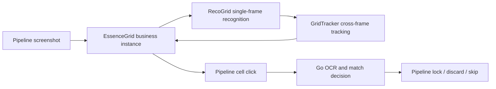

# RecoGrid / GridTracker / EssenceGrid Architecture

Essence inventory scanning is composed of three C++ modules that can each be understood on their own, instead of one monolithic engine that owns recognition, tracking, and business flow:



## Module boundaries

| Module | Owns | Does not own |
| --- | --- | --- |
| `RecoGrid` | Rows, columns, cell rectangles, occupancy, pHash, and comparison features for one image | Frame history, scroll order, business quality, clicks |
| `GridTracker` | Adjacent-frame alignment, global row/column indices, deduplication, order, and end confirmation | Image segmentation, template loading, Pipeline routing |
| `EssenceGrid` | Essence quality, lock/discard thumbnails, pending queue, and Maa callbacks | Skill OCR, match rules, actual UI actions |
| Go `essencefilter` | OCR normalization, target combination matching, Lock/Discard/Skip decisions | Grid recognition and button clicks |
| Pipeline | Screenshot timing, clicks, swipes, waits, and post-action verification | Image algorithms and match data structures |

More precise module documentation lives next to the source code:

- [RecoGrid README](../../../../agent/cpp-algo/source/RecoGrid/README.md)
- [GridTracker README](../../../../agent/cpp-algo/source/GridTracker/README.md)
- [EssenceGrid README](../../../../agent/cpp-algo/source/EssenceGridScan/README.md)
- [EssenceFilter Go README](../../../../agent/go-service/essencefilter/README.md)

## RecoGrid: one frame only

Public entry point:

```cpp
recogrid::GridFrame RecognizeGrid(
    const cv::Mat& image,
    const recogrid::GridRecognitionOptions& options = {});
```

Recognition performs these steps:

1. map the screenshot to `normalizedSize`;
2. crop `roi` and detect row/column projection segments;
3. construct regular cells and project them back to screenshot coordinates;
4. mask fixed cell decorations;
5. compute occupancy, pHash, and compact color features.

### Main inputs

| Field | Meaning |
| --- | --- |
| `detect.normalizedSize` | Coordinate base; MaaEnd normally uses `1280x720` |
| `detect.roi` | Grid region |
| `rowThresholdRatio` / `colThresholdRatio` | Row/column projection thresholds |
| `minRawSegmentLength` | Minimum raw segment length |
| `minKeptSegmentRatio` | Segment size retained relative to the modal cell size |
| `lockedRowHeight` / `lockedColWidth` | Cell size locked after the first frame to stabilize later detection |
| `mask` | Ignores fixed corner badges or the bottom area inside each cell |
| occupancy brightness options | Decide whether a cell contains content |

### Main outputs

`GridFrame` contains the row and column counts, modal cell width and height, diagnostics, and the `GridCell` list. Each `GridCell` contains its local row and column, current-frame index, screen rectangle, features, and `occupied`.

RecoGrid does not load item-classification templates or keep sessions. An empty image, invalid channels, or no detected grid returns an empty `GridFrame`, and the caller decides how to retry.

## GridTracker: order and end across frames

Public entry point:

```cpp
gridtracker::Result observe(
    const recogrid::GridFrame& frame,
    const gridtracker::Options& options = {});
```

Each scrolling task holds one `GridTracker`. Call `reset()` when a new task starts.

### Status

| Status | Meaning | EssenceGrid route |
| --- | --- | --- |
| `Initial` | First valid frame | Process new cells; scroll if there are no candidates |
| `Advanced` | Forward progress, or a baseline refresh at zero offset without a complete repeat (e.g., a row count change) | Process new cells; scroll if there are no candidates |
| `ConfirmingEnd` | First complete repeat | Scroll once more to confirm |
| `Repeated` | Second consecutive complete repeat | Finish |
| `Rejected` | Empty frame, column count change, low-confidence alignment, or a complete zero-offset repeat below `repeat_match_ratio` | Return recognition failure and let Maa retry on the same screen |

### Alignment and deduplication

The tracker enumerates non-negative row offsets in the previous frame and chooses a candidate in this order:

1. higher ratio of matched cells;
2. lower average feature distance;
3. more cells taking part in the comparison.

A candidate must also satisfy minimum overlap rows and `min_match_ratio`. Once a positive offset is accepted, local rows are mapped to `viewport_start_row + local_row`.

The business layer only consumes `Result::new_cells`. The tracker has already deduplicated by global `(row, col)`; the outer layer must not maintain a second deduplication table.

### Why the end is confirmed twice

`row_offset == 0` alone does not prove the end has been reached. A complete repeat requires all of:

- identical row and column shape;
- complete `rows * cols` cell vectors in both frames;
- every cell participating in comparison;
- `repeat_match_ratio` being met.

The first complete repeat returns `ConfirmingEnd`, and Pipeline scrolls once more. Only a second consecutive repeat returns `Repeated`. Any valid progress, shape change, or failed recognition clears pending confirmation.

## EssenceGrid: the essence business instance

`main.cpp` creates one `EssenceGrid` and registers both of these through `trans_arg`:

- `EssenceGridAdvanceRecognition`;
- `EssenceGridPendingRecognition`.

The instance holds the tracker, task id, merged configuration, thumbnail templates, current page queue, and pending cell. A change of task id resets the tracker and the queue.

### `EssenceGridAdvance.attach`

| Field | Purpose |
| --- | --- |
| `roi`, `normalized_size`, row/column thresholds, segment parameters | Build the RecoGrid options |
| `repeat_match_ratio` | Build the GridTracker options |
| `thumb_lock_template_paths` | Recognize locked thumbnails |
| `thumb_discard_template_path` | Recognize discarded thumbnails |
| `flawless_essence` / `pure_essence` | Quality filter |
| `skip_thumb_lock` / `skip_thumb_discard` | Thumbnail state filter |

MaaFramework first dictionary-merges base resources, task options, and controller resources; C++ then reads the final `attach` through `MaaContextGetNodeData`. Do not mirror these fields in Go.

### Queue construction

EssenceGrid processes only tracker `new_cells`:

1. sample the color at the bottom of the cell to judge Flawless/Pure quality;
2. match lock/discard thumbnails in the lower-left cell region;
3. apply the quality and skip options;
4. enqueue accepted cells;
5. `PendingRecognition` returns the screen rectangle and Pipeline performs the click.

## Go and Pipeline

After Pipeline clicks a cell, OCR nodes read the three skills and their levels. Go's `runUnifiedSkillDecision` only decides the branch:

- target matched: go to `EssenceFilterLockItem`;
- no match and discarding enabled: go to `EssenceFilterDiscardItem`;
- otherwise: return to `EssenceGridAdvance`.

Pipeline owns the actual button recognition, clicking, and `EssenceFilterCheckLocked` / `EssenceFilterCheckDiscarded` verification. Go must not route directly to a post-action check node, because doing so skips the operation.

## Controller differences

The base resource defines Win32 geometry. `resource_adb` and other controller resources should override only the ROIs, templates, and swipe parameters that actually differ.

Lock and discard buttons need separate ROIs. A Pipeline `Click` uses the box returned by template matching; one broad ROI can let a similar template select the neighboring button.

## Troubleshooting

| Symptom | First owner to inspect |
| --- | --- |
| Wrong rows, columns, or cell rectangles | RecoGrid ROI and segment settings |
| Accumulated row misalignment, duplicates, or early finish | GridTracker offset, support, match ratio, and status |
| Wrong quality or lock/discard thumbnail state | EssenceGrid HSV and thumbnail templates |
| Unexpected skill match | Go OCR normalization, data, and match options |
| Wrong or unconfirmed lock/discard click | Pipeline template, ROI, waits, and next order |

## Build

The three modules are ultimately composed by the production `cpp-algo`:

```powershell
cmake --build agent\cpp-algo\build --config RelWithDebInfo --target cpp-algo
```

In CMake, `recogrid` and `grid-tracker` are independent static libraries; `EssenceGrid` is compiled into `cpp-algo`.
