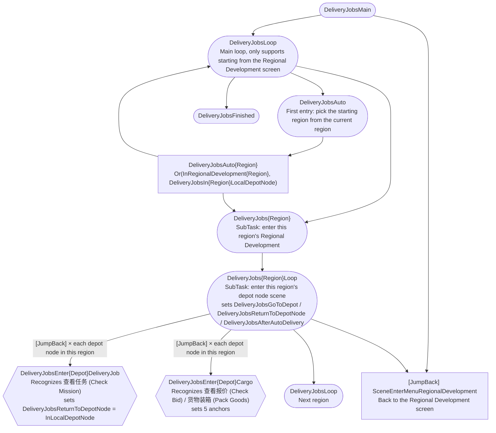
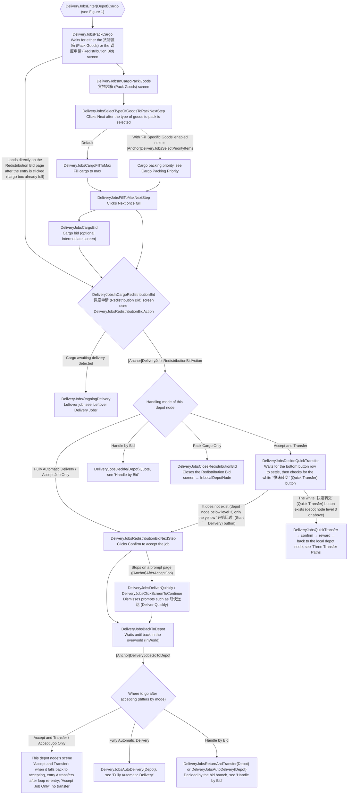
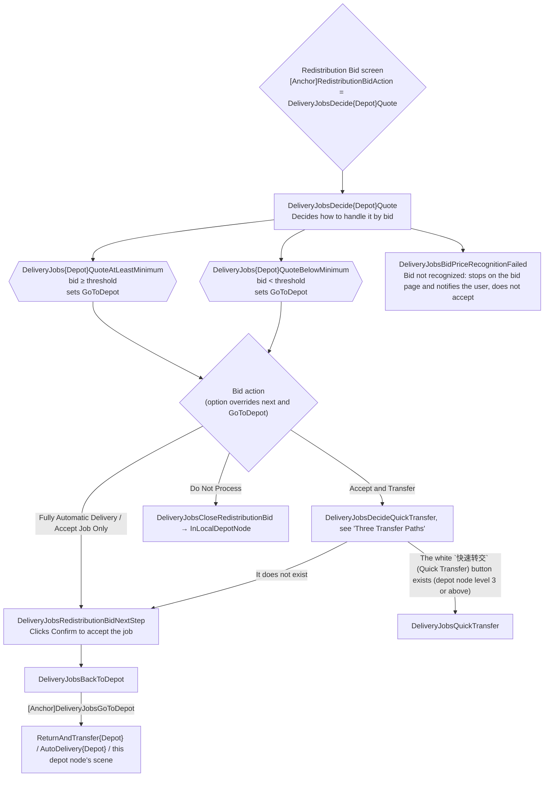
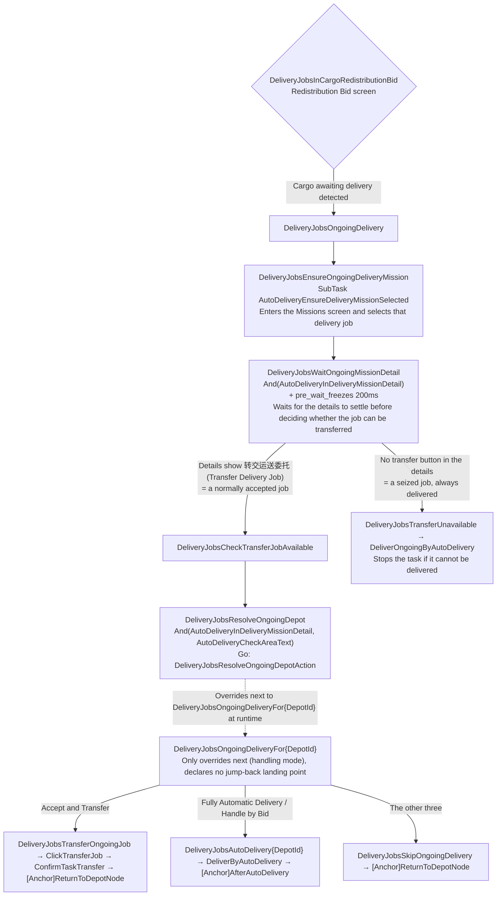
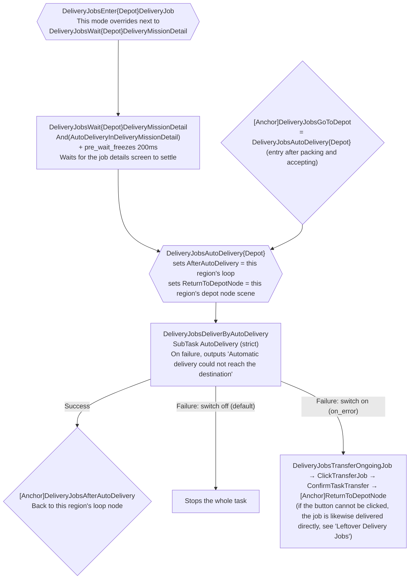
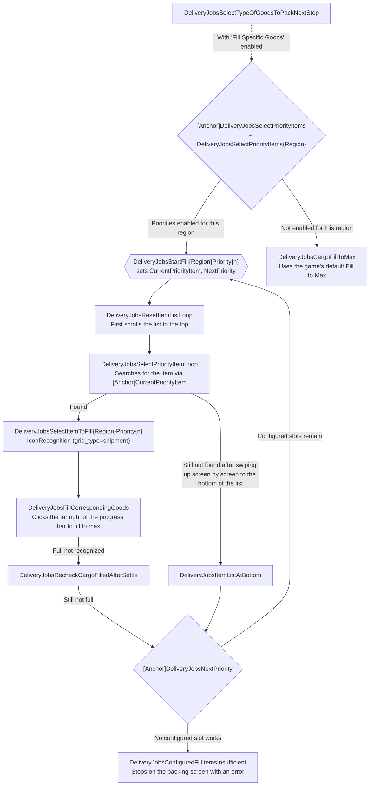

# Development Manual - DeliveryJobs

`DeliveryJobs` (task name "Delivery Jobs") traverses all depot nodes according to the regions and depot nodes configured by the user, packing cargo for delivery jobs, accepting the jobs, and transferring them; optionally it hands the cargo to [AutoDelivery](../components/auto-delivery.md) for fully automatic delivery.

Three structural conventions of this task:

1. **Do not hand-edit generated artifacts**: `pipeline/DeliveryJobs.json`, `pipeline/DeliveryJobs/{Region,Depot}/**`, `PriorityItems.json`, and `assets/tasks/DeliveryJobs.json` are all generated by `tools/pipeline-generate/DeliveryJobs/`. The hand-written flow lives in only three files: `PackCargo.json`, `TransferJob.json`, and `AutoDelivery.json`.
2. **Anchors are the backbone of this flow**: the same shared node is reused by multiple depot nodes and multiple handling modes and does not know whom it is serving, so "where to go next" is passed almost entirely through anchors. Read the [Anchor Overview](#anchor-overview) before changing the flow.
3. **The jump-back landing point is declared by the region loop that started the traversal**: `DeliveryJobsReturnToDepotNode` means "the depot node landing point of the region the current traversal is in" and is unrelated to where a leftover job belongs.

Go Service only provides `DeliveryJobsResolveOngoingDepotAction` (`agent/go-service/deliveryjobs/`), which parses the job details to find out which depot node a leftover job belongs to. The task follows "Pipeline owns flow, Go owns algorithms".

## At a Glance

- **Entry**: the `DeliveryJobs` task in `assets/tasks/DeliveryJobs.json` → Pipeline entry `DeliveryJobsMain`, group `regional_development`. The task name and all option names are persisted configuration keys; renaming them invalidates users' existing configurations.
- **Two-level configuration**: first switch regions on or off (Valley IV / Wuling), then choose a handling mode for each depot node (one of six). The handling mode decides which flow that depot node takes.
- **The unit of traversal is the depot node**: every candidate of the region loop carries `[JumpBack]`, so when a sub-chain finishes, control returns to the loop node, which then tries the next candidate. "Automatically moving on to the next depot node after finishing one" is therefore implemented by loop re-entry, and no depot node needs to declare its own successor.
- **The same depot node may be visited twice in one run**: below depot node level 3, packing can only accept the job and the transfer is deferred to a later `查看任务` (Check Mission) entry (for the three paths, see [Three Transfer Paths](#three-transfer-paths)).

## Flow Overview

In the diagrams, `sets X` / `uses X` in node labels mark anchors: a hexagon `{{}}` declares an anchor, a rhombus `{}` reads an anchor (`[Anchor]X` in `next`), and dashed lines are edges produced by option overrides. `{Depot}` / `{Region}` stand for the MaaEnd identifiers of the current depot node and region (for example `OriginiumSciencePark` / `ValleyIV`).

### Figure 1: Entry, Region Loop, and the Two Depot Node Entries



### Figure 2: Packing → Redistribution Bid Screen → Dispatch by Handling Mode



## Depot Node Handling Modes

Each depot node has one `select`, defaulting to "Accept and Transfer". The six modes are implemented by overriding the node properties of that depot node (`deliveryEnabled` / `cargoEnabled` are the `enabled` of `DeliveryJobsEnter{Depot}DeliveryJob` / `DeliveryJobsEnter{Depot}Cargo`):

| Handling mode | Entries enabled | Packing recognition text | Redistribution Bid screen action | After accepting |
| --- | --- | --- | --- | --- |
| Accept and Transfer | Both enabled | `查看报价` (Check Bid) / `货物装箱` (Pack Goods) | `DeliveryJobsDecideQuickTransfer` (quick-transfers when the white `快速转交` (Quick Transfer) button exists, otherwise falls back to `DeliveryJobsRedistributionBidNextStep`) | Quick transfer returns straight to the depot node; on the fallback, `DeliveryJobsDeliverQuickly` → back to the depot node |
| Fully Automatic Delivery | Both enabled | `查看报价` (Check Bid) / `货物装箱` (Pack Goods) | `DeliveryJobsRedistributionBidNextStep` | `DeliveryJobsAutoDelivery{Depot}` |
| Handle by Bid | Cargo entry only | `查看报价` (Check Bid) / `货物装箱` (Pack Goods) | `DeliveryJobsDecide{Depot}Quote` | Decided by the bid branch |
| Accept Job Only | Cargo entry only | `查看报价` (Check Bid) / `货物装箱` (Pack Goods) | `DeliveryJobsRedistributionBidNextStep` | Back to the depot node, no transfer |
| Pack Cargo Only | Cargo entry only | `货物装箱` (Pack Goods) only | `DeliveryJobsCloseRedistributionBid` | Closes the Redistribution Bid screen and returns to the depot node |
| Do Not Process | Both disabled | — | — | — |

A few points that are easy to misread:

- **The transfer of "Accept and Transfer" may complete inside the packing flow, or may be deferred until loop re-entry.** When the depot node is level 3 or above, the Redistribution Bid screen offers the white `快速转交` (Quick Transfer) button next to the yellow `开始运送` (Start Delivery) button, and the packing flow hands the job over right away (see path 1 in [Three Transfer Paths](#three-transfer-paths)); below level 3 the screen only has the yellow `开始运送` (Start Delivery) button, so the flow can only accept the job first and transfer it when the next round of the region loop hits entry A (which recognizes `查看任务` (Check Mission)), so the same depot node may be visited twice in one run.
- **"Accept Job Only" and "Pack Cargo Only" achieve "no transfer" by disabling entry A**, not by a check in the flow; so under these two modes, delivery jobs the depot node already has are never transferred; both modes still reach the Redistribution Bid screen, though, so a seized job in hand is still always delivered, see [Leftover Delivery Jobs](#leftover-delivery-jobs).
- **The packing recognition of "Pack Cargo Only" accepts only `货物装箱` (Pack Goods)**, not `查看报价` (Check Bid): the entry shows `查看报价` when the cargo box is already full, and shows `货物装箱` only when it is not full.
- **"Do Not Process" does not override the leftover-job dispatch node**; it takes the template default `DeliveryJobsSkipOngoingDelivery` (see [Leftover Delivery Jobs](#leftover-delivery-jobs)).
- **The handling mode also decides where leftover jobs go**: `deliveryEnabled` / `cargoEnabled` only toggle the entries; the leftover-job action of the same select is written separately by the generator into `DeliveryJobsOngoingDeliveryFor{Depot}.next` (see [Leftover Delivery Jobs](#leftover-delivery-jobs)).

### Three Transfer Paths

Within the same depot node, there are three independent paths for "handing over the job in the box"; when troubleshooting, do not watch only one of them:

| # | Trigger | Nodes passed through | When this path is taken |
| --- | --- | --- | --- |
| 1 | The Redistribution Bid screen offers the white `快速转交` (Quick Transfer) button next to the yellow `开始运送` (Start Delivery) button | `DeliveryJobsDecideQuickTransfer` → `DeliveryJobsQuickTransfer` → `DeliveryJobsQuickTransferConfirm` → `DeliveryJobsQuickTransferReward` → `DeliveryJobsQuickTransferBackToLocalDepotNode` | "Accept and Transfer" (as the depot node mode or as the bid action) while the depot node is level 3 or above: the packing flow hands the job over on the spot without accepting it |
| 2 | After loop re-entry, entry A `查看任务` (Check Mission) is hit | `DeliveryJobsClickTransferJob` → `DeliveryJobsConfirmTaskTransfer` | Under "Accept and Transfer", when entry A is enabled and the depot node still has `max_hit` quota left ("Fully Automatic Delivery" re-points entry A's `next` to delivery) |
| 3 | The Redistribution Bid screen detects cargo already awaiting delivery | `DeliveryJobsOngoingDelivery` → `DeliveryJobsEnsureOngoingDeliveryMission` → `DeliveryJobsWaitOngoingMissionDetail`: **first decide whether this job can be transferred** (`转交运送委托` (Transfer Delivery Job) in the details = a normally accepted job; absent = a seized job). Only a transferable job goes through `DeliveryJobsOngoingDeliveryFor{Depot}` according to the mode of the depot node it belongs to ("Accept and Transfer" → `DeliveryJobsTransferOngoingJob`; "Fully Automatic Delivery" and "Handle by Bid" → `DeliveryJobsAutoDelivery{DepotId}`; any other mode → `DeliveryJobsSkipOngoingDelivery`); a seized job always goes through `DeliveryJobsTransferUnavailable` → `DeliveryJobsDeliverOngoingByAutoDelivery` to be delivered | When the job in hand has not been handed over yet and the flow enters this depot node's packing / Redistribution Bid flow again |

> [!NOTE]
>
> **Path 1 exists only when the depot node is level 3 or above; below level 3 it automatically falls back to accepting the job.** The white `快速转交` (Quick Transfer) button is unlocked at depot node level 3, so below level 3 the Redistribution Bid screen only has the yellow `开始运送` (Start Delivery) button. That is why "Accept and Transfer" enters `DeliveryJobsDecideQuickTransfer` first: it uses `And(YellowConfirmButtonType1, DeliveryJobsInCargoRedistributionBid)` to confirm the bottom button row has been rendered (the yellow `开始运送` (Start Delivery) button exists at every level, so it serves as the "button row is in place" signal), then applies `pre_wait_freezes` to that button row to wait for the screen to settle, and only then tries `DeliveryJobsQuickTransfer` (which matches only the white Quick Transfer button); on a hit it takes path 1, otherwise it falls back to `DeliveryJobsRedistributionBidNextStep` and accepts the job the old way. Which path then transfers the job depends on the configuration: when the depot node's handling mode is "Accept and Transfer", the next round of the region loop hits entry A to transfer (path 2); when "Handle by Bid" uses "Accept and Transfer" as its bid action, `DeliveryJobsReturnAndTransfer{Depot}` leads into [`DeliveryJobsEnter{Depot}PriceDeliveryJob`](#deliveryjobsenterdepotpricedeliveryjob) to transfer, without going through entry A (entry A is disabled under that mode). **Never judge "there is no Quick Transfer button" before the buttons finish rendering**, as that would send a job that should be quick-transferred down the accept path.

### `DeliveryJobsEnter{Depot}PriceDeliveryJob`

It has exactly the same recognition, anchor, and `next` as `DeliveryJobsEnter{Depot}DeliveryJob`, and both carry `max_hit: 1`. Under "Handle by Bid", entry A is `enabled: false` while this node stays enabled; when that mode's bid action is "Accept and Transfer", `DeliveryJobsReturnAndTransfer{Depot}` points to it.

## Handle by Bid

After "Handle by Bid" is selected, three extra options appear for that depot node:

| Option | Type | Default | Purpose |
| --- | --- | --- | --- |
| Bid Processing Threshold | input | 119000 | Integer value compared with the currently selected bid, validated against `^\d+$` |
| At or Above the Threshold | select | Accept and Transfer | Which action runs when bid ≥ threshold |
| Below the Threshold | select | Accept Job Only | Which action runs when bid < threshold |

The threshold and the two action options are all **independent per depot node** (`DeliveryJobsQuoteThreshold{DepotId}`, `DeliveryJobsAtLeastMinimumQuoteAction{DepotId}`, `DeliveryJobsBelowMinimumQuoteAction{DepotId}`), and appear only when that depot node selects "Handle by Bid".



Implementation notes:

- The threshold is injected into `ExpressionRecognition.expression` with `pipeline_type: string`; the actual comparisons are `{DeliveryJobsSelectedBidPrice}>={threshold}` and `{DeliveryJobsSelectedBidPrice}<{threshold}`. **`pipeline_type` must stay `string`**: setting it to `int` tries to convert the whole expression into an integer, which ends up as `null`.
- Each of the two actions is one of four, and the values are **not shared** with the depot node handling modes: `Accept and Transfer` / `Fully Automatic Delivery` / `Accept Job Only` / `Do Not Process`; there are no "Handle by Bid" or "Pack Cargo Only" values.
- **"How to accept" is expressed by the node's `next`; "where to go after accepting" is expressed only by `DeliveryJobsGoToDepot`.** "Fully Automatic Delivery" and "Accept Job Only" share the same `DeliveryJobsRedistributionBidNextStep`, while "Accept and Transfer" has an extra `DeliveryJobsDecideQuickTransfer` in front (quick-transfers without accepting when the white `快速转交` (Quick Transfer) button exists, otherwise falls back to the same `DeliveryJobsRedistributionBidNextStep`); after accepting, the only difference is the anchor value: `DeliveryJobsReturnAndTransfer{Depot}` (return to the depot node and transfer), `DeliveryJobsAutoDelivery{Depot}` (hand over to fully automatic delivery), or this depot node's scene (just go back).
- These overrides are written by the options directly into the `next` and `anchor.DeliveryJobsGoToDepot` of `DeliveryJobs{Depot}QuoteAtLeastMinimum` / `DeliveryJobs{Depot}QuoteBelowMinimum`. "Do Not Process" points `next` at `DeliveryJobsCloseRedistributionBid`; the flow then does not pass through `DeliveryJobsBackToDepot`, and `DeliveryJobsGoToDepot` plays no part.
- `pipeline_override` **replaces** both the `anchor` object and the `next` array **as a whole**, so an override must give the complete field, not just the entry you want to change.
- When bid OCR fails (`DeliveryJobsBidPriceRecognitionFailed`), the task runs `StopTask` right away and stays on the bid page; it neither guesses nor accepts automatically.
- **Leftover jobs skip the bid check**: `DeliveryJobsOngoingDeliveryFor{Depot}.next` is overridden to `DeliveryJobsAutoDelivery{Depot}` (`DeliveryJobsSkipOngoingDelivery` for depot nodes without an assigned destination); for the reasons and consequences, see [Leftover Delivery Jobs](#leftover-delivery-jobs).

## Leftover Delivery Jobs

When `有待运送的货物，请先完成送货` (Finish the ongoing delivery first) is recognized on the Redistribution Bid screen, the `next` of `DeliveryJobsInCargoRedistributionBid` hits `DeliveryJobsOngoingDelivery` first and enters leftover-job handling instead of running this depot node's Redistribution Bid action:



`DeliveryJobsResolveOngoingDepotAction` matches the OCR text of the "current area" in the job details against the depot nodes and overrides `next` with the corresponding dispatch node. The dispatch is based on the handling mode of **the depot node the leftover job belongs to**, regardless of which depot node is currently being traversed — the leftover job may come from the previous depot node, or from a node this run never reached at all:

| Handling mode of the owning depot node | Goes to | Result |
| --- | --- | --- |
| Accept and Transfer | `DeliveryJobsTransferOngoingJob`; falls back to `DeliveryJobsDeliverOngoingByAutoDelivery` when the screen has no transfer button | After the transfer, returns to the local region's depot node and continues the region loop; after a successful fallback delivery, returns to the region loop; if the delivery fails, the task stops |
| Fully Automatic Delivery / Handle by Bid | `DeliveryJobsAutoDelivery{DepotId}` | Returns to the region loop after delivering it |
| Accept Job Only / Pack Cargo Only | `DeliveryJobsSkipOngoingDelivery` | Leaves the Missions screen and returns to the local region's depot node to continue the traversal |
| Do Not Process | Same as above (the dispatch node is not overridden; the template default applies) | Same as above |

The table above applies only to **transferable jobs**: seized jobs have already been routed away at `DeliveryJobsWaitOngoingMissionDetail` (always delivered), never reach `DeliveryJobsResolveOngoingDepot`, and ignore every depot node's configuration.

> [!NOTE]
>
> **Leftover jobs under "Handle by Bid" skip the bid check and go straight to fully automatic delivery.** An accepted job no longer has a bid to look at, and skipping it would keep blocking the Redistribution Bid screen, so later depot nodes could not even accept new jobs; only depot nodes that have no assigned destination in `delivery_destinations.json` have nowhere to deliver to, and only those fall back to `DeliveryJobsSkipOngoingDelivery` (all five current depot nodes have destinations, so this branch takes effect only when a depot node without a destination is added). An automatic delivery failure is still handled by the `on_error` of the shared call node `DeliveryJobsDeliverByAutoDelivery`: by default the task stops; with "Auto-transfer job after delivery fails" turned on, the job is transferred and the run continues.
>
> **Seized jobs are always delivered, regardless of depot node configuration.** The game does not allow a delivery job obtained by seizing jobs (🏍️Accept Commission & Delivery) to be transferred again: its job details have no `转交运送委托` (Transfer Delivery Job), only `开始追踪` (Track). Once `DeliveryJobsWaitOngoingMissionDetail` concludes "no button", the flow goes through `DeliveryJobsTransferUnavailable` → `DeliveryJobsDeliverOngoingByAutoDelivery` to deliver it; if the delivery fails, the task stops and outputs "Automatic delivery could not reach the destination". Normally accepted jobs are not affected by this (they can still be transferred even when the cargo is already in hand), so this is not a generic fallback for "cargo in hand" but a branch specific to the seizing path. This rule has the same origin as the way the seize task handles a job already in hand: the `next` of `SeizeDeliveryJobsHandleOngoingJob` is likewise "transfer if there is a transfer button, otherwise hand over to the post-processing option" (it can run into a transfer button because it may also be handling a normally accepted job).
>
> **The page must settle before deciding whether a job can be transferred.** Whether the transfer button is present decides between two destinations at once, "handle by depot node configuration" and "always deliver": deciding while the page is still rendering would treat a job that should be transferred as a seized one and deliver it directly. So after `DeliveryJobsEnsureOngoingDeliveryMission`, the flow first passes through `DeliveryJobsWaitOngoingMissionDetail` (`And(AutoDeliveryInDeliveryMissionDetail)` + `pre_wait_freezes 200ms` on the details area), and only once the page has settled does `DeliveryJobsCheckTransferJobAvailable` decide — the same idea as the gate node `DeliveryJobsWait{Depot}DeliveryMissionDetail` on the edge from entry A.

The area name in the job details and the depot node name are identical, character for character, in all five languages, which is what lets the Go side build the node name `DeliveryJobsOngoingDeliveryFor{ID}` directly from the area ID; this identity is asserted by `model.mjs` at generation time, so the two sides do not each keep their own mapping. The depot node name on the Go side is taken from `global.region.{DepotId}`, the same source as the node name suffix.

This chain changes the normal flow, so every step outputs a Focus message to the user explaining the reason and the action taken; all messages of this task start with 🚚 so that they can be told apart in the run log from the messages of other modules (such as 🚛 during the fully automatic delivery stage):

| Node | Message | Text source |
| --- | --- | --- |
| `DeliveryJobsOngoingDelivery` | 🚚 Found an unfinished delivery job; opening it in the Delivery Jobs list for details. | `task.DeliveryJobs.OngoingDeliveryDetected` (interface locale) |
| `DeliveryJobsResolveOngoingDepotAction` (Go) | 🚚 The delivery job belongs to \<depot node name\> | `deliveryjobs.focus.ongoing_depot_resolved` (go-service locale) |
| Same as above, resolution failed | 🚚 Could not determine which depot node the unfinished delivery job belongs to. See the run log for details. | `deliveryjobs.focus.ongoing_depot_unresolved` (go-service locale) |
| `DeliveryJobsSkipOngoingDelivery` | 🚚 The depot node this delivery job belongs to does not handle it, so it was skipped and the run continued at the depot node. | `task.DeliveryJobs.OngoingDeliverySkipped` (interface locale) |
| `DeliveryJobsDeliverByAutoDelivery` (action failed) | 🚚 Automatic delivery could not reach the destination. | `task.DeliveryJobs.AutoDeliveryFailed` (interface locale) |
| `DeliveryJobsTransferOngoingJob` | 🚚 Transferring it according to the setting of the depot node this delivery job belongs to. | `task.DeliveryJobs.OngoingDeliveryTransferred` (interface locale) |
| `DeliveryJobsTransferUnavailable` | 🚚 A commission taken via Accept Commission cannot be transferred; preparing to deliver it automatically. | `task.DeliveryJobs.OngoingDeliveryTransferUnavailable` (interface locale) |
| `DeliveryJobsDeliverOngoingByAutoDelivery` (action failed) | 🚚 Automatic delivery could not reach the destination. | `task.DeliveryJobs.AutoDeliveryFailed` (interface locale) |

The detection message is output by `DeliveryJobsOngoingDelivery` when it recognizes the prompt text, and the ownership message by the Go side once it has resolved the area; the two exits each state the action they take, and each message says only what is new at that step. The automatic delivery failure reason is attached to the action failure of the shared call node, so it is shown whether the switch is on or off; the switch only decides whether to transfer after a failure. The switch applies only to `DeliveryJobsDeliverByAutoDelivery`; the fallback path `DeliveryJobsDeliverOngoingByAutoDelivery` does not read it.

## Fully Automatic Delivery



"Fully Automatic Delivery" is offered only on depot nodes that have an assigned destination in `delivery_destinations.json` — a depot node without a destination has nowhere to deliver to, so neither the depot node handling mode nor the two bid actions offer this choice.

- **The edge from entry A gains a gate node, `DeliveryJobsWait{Depot}DeliveryMissionDetail`**: it recognizes `And(AutoDeliveryInDeliveryMissionDetail)` and waits for the job details area to stay still for 200ms (the wait area is the same as that of the component's `AutoDeliveryInDeliveryMissionDetail`), then proceeds to `DeliveryJobsAutoDelivery{Depot}`.
- The other two entries into `DeliveryJobsAutoDelivery{Depot}` do not pass through this gate: `[Anchor]DeliveryJobsGoToDepot` after packing and accepting, and `DeliveryJobsOngoingDeliveryFor{DepotId}` for leftover jobs.
- DeliveryJobs does not put `AutoDelivery` directly into `next`. Each depot node's `DeliveryJobsAutoDelivery{Depot}` only declares the jump-back anchors (`DeliveryJobsAfterAutoDelivery`, `DeliveryJobsReturnToDepotNode`) and then hands over to the shared call node `DeliveryJobsDeliverByAutoDelivery`; the fallback delivery of leftover jobs (seized jobs, or a button that cannot be clicked in the transfer flow) calls `DeliveryJobsDeliverOngoingByAutoDelivery` directly (see [Leftover Delivery Jobs](#leftover-delivery-jobs)).
- Both shared call nodes wrap `AutoDelivery` in a strict `SubTask`, so a failure at any step inside the component surfaces on their own action, and `on_error` only needs to be configured in that one place: the failure of `DeliveryJobsDeliverByAutoDelivery` is decided by the "Auto-transfer job after delivery fails" switch; `DeliveryJobsDeliverOngoingByAutoDelivery` deliberately has no `on_error`, so a failure stops the task, which keeps it from looping back and forth with the transfer. Whether the current stage is pickup or delivery is decided by the component itself from the job details, so callers need no extra entry or anchor for the details switching.
- The "Prefer Ziplines for Delivery" switch is passed to AutoDelivery through `attach.zip` of `AutoDeliveryNavigateDepot` / `AutoDeliveryNavigateDestination` (the Go side reads exactly the `attach` of these two nodes). It only allows navigation to use a zipline when that is expected to be faster and the zipline is powered and can be mounted and dismounted normally; it does not guarantee that every route will pick a zipline. Targets that declare `zipline_only` in `routes.json` (such as Pei Lingrong) are the exception: they can only be reached by zipline, so when the switch is off, AutoDelivery outputs a message and fails the action right away instead of trying to walk (see [AutoDelivery component maintenance](../components/auto-delivery.md)).
- The "Auto-transfer job after delivery fails" switch sets `DeliveryJobsDeliverByAutoDelivery.on_error` to `DeliveryJobsTransferOngoingJob`. When it is off (the default), a fully automatic delivery failure stops the whole task and only outputs the failure reason; when it is on, the transfer node takes over, automatically transfers the current job, and continues the region loop. This feature is still in testing. The switch applies only to `DeliveryJobsDeliverByAutoDelivery`; the fallback delivery used when transfer is unavailable (`DeliveryJobsDeliverOngoingByAutoDelivery`) does not read it and stops the task when the delivery fails, so even with the switch on, the flow never loops "transfer → deliver → transfer".

## Cargo Packing Priority

With "Fill Specific Goods" enabled, the `next` of `DeliveryJobsSelectTypeOfGoodsToPackNextStep` changes from the default "fill cargo to max" to `[Anchor]DeliveryJobsSelectPriorityItems`, and the flow switches to the priority search. The option expands per region, and each region can set 4 priority slots (`WhatToFill{Region}Priority1..4`).



- Each slot configures its item independently; the value is a stable item ID, and the display names reuse `iconRecognition.name.*`. By default, priority 1 is Sandleaf Powder and priorities 2 to 4 are "Not specified".
- Every priority slot uses the same per-region item list, which the generator computes as the intersection of `fillable_items` over the depot nodes of the region; `DeliveryJobsSelectItemToFill*` has its own set of ROIs under ADB (`resource_adb/pipeline/DeliveryJobs/PriorityItems.json`).
- When none of the configured items can fill the box, `DeliveryJobsConfiguredFillItemsInsufficient` reports an error and stops on the packing screen instead of silently continuing.
- When the option is disabled, the flow goes through `DeliveryJobsCargoFillToMax`, which uses the game's default Fill to Max.

## Anchor Overview

The shared nodes of DeliveryJobs do not know which depot node they are serving, so all context is passed through anchors. Eight are currently in use, and every declaration and read site is inside the Pipeline, the only exception being `DeliveryJobsSelectPriorityItems` (its reader is in an option of `assets/tasks/DeliveryJobs.json`):

| Anchor | Declared by | Consumed by | Screen when read |
| --- | --- | --- | --- |
| `DeliveryJobsReturnToDepotNode` | `DeliveryJobs{Region}Loop`, `DeliveryJobsEnter{Depot}DeliveryJob`, `DeliveryJobsEnter{Depot}PriceDeliveryJob`, `DeliveryJobsEnter{Depot}Cargo`, `DeliveryJobsAutoDelivery{Depot}` | `DeliveryJobsConfirmTaskTransfer`, `DeliveryJobsSkipOngoingDelivery` | Missions screen (transfer confirmation dialog / job details) |
| `DeliveryJobsGoToDepot` | `DeliveryJobs{Region}Loop`, `DeliveryJobsEnter{Depot}Cargo`, `DeliveryJobs{Depot}QuoteAtLeastMinimum/BelowMinimum` | `DeliveryJobsBackToDepot` | Overworld |
| `DeliveryJobsSelectPriorityItems` | `DeliveryJobsEnter{Depot}Cargo` | `DeliveryJobsSelectTypeOfGoodsToPackNextStep` (in a task option) | Pack Goods screen |
| `DeliveryJobsRedistributionBidAction` | `DeliveryJobsEnter{Depot}Cargo` | `DeliveryJobsInCargoRedistributionBid` | Redistribution Bid screen |
| `DeliveryJobsAfterAcceptJob` | `DeliveryJobsEnter{Depot}Cargo` | `DeliveryJobsRedistributionBidNextStep` | Redistribution Bid screen (after clicking Confirm to accept) |
| `DeliveryJobsCurrentPriorityItem` | `DeliveryJobsStartFill{Region}Priority{1..4}` | `DeliveryJobsSelectPriorityItemLoop` | Packing item list |
| `DeliveryJobsNextPriority` | `DeliveryJobsStartFill{Region}Priority{1..4}` | `DeliveryJobsRecheckCargoFilledAfterSettle`, `DeliveryJobsItemListAtBottom` | Packing item list |
| `DeliveryJobsAfterAutoDelivery` | `DeliveryJobs{Region}Loop`, `DeliveryJobsAutoDelivery{Depot}` | `DeliveryJobsDeliverByAutoDelivery`, `DeliveryJobsDeliverOngoingByAutoDelivery` | Screen after the delivery ends |

For every anchor in the table except `DeliveryJobsReturnToDepotNode`, the reader is a shared node used across depot nodes or across regions, and the value changes with the declarer: `DeliveryJobsSelectPriorityItems` takes the local region's priority entry, `DeliveryJobsRedistributionBidAction` and `DeliveryJobsAfterAcceptJob` change with the depot node's handling mode, and `DeliveryJobsGoToDepot` changes with where the flow goes after accepting.

### `DeliveryJobsReturnToDepotNode`: Landing Point at the Local Region's Depot Node

Where to return after the transfer is confirmed depends on which screen started the transfer: a transfer started from the depot node screen still ends on the depot node screen; a transfer started from the Missions screen lands on the menu list and has to re-enter the depot node. `DeliveryJobsConfirmTaskTransfer` does not check the screen; it only jumps according to this anchor.

The rule is: **the jump-back belongs to the region loop that started the traversal, and whoever is traversing declares it**:

| Declared by | Value | Scenario |
| --- | --- | --- |
| `DeliveryJobs{Region}Loop` | Local region's depot node scene | Loop entry: used by flows in the current iteration that have not passed through a more specific declarer |
| `DeliveryJobsEnter{Depot}DeliveryJob` | `InLocalDepotNode` | The transfer is started on the depot node screen, so after it only the screen load needs to be awaited |
| `DeliveryJobsEnter{Depot}PriceDeliveryJob` | `InLocalDepotNode` | Same as above (bid-qualified path) |
| `DeliveryJobsEnter{Depot}Cargo` | Local region's depot node scene | Enters packing from the depot node screen and, when it meets a leftover job, switches to the Missions screen to handle it; it supplies the landing point of `DeliveryJobsSkipOngoingDelivery` |
| `DeliveryJobsAutoDelivery{Depot}` | Local region's depot node scene | Transfer after a fully automatic delivery failure, which has to exit from the Missions screen |

There are two consumers, both of the "return to the depot node after leaving the Missions screen" kind: `DeliveryJobsConfirmTaskTransfer` (transfer confirmation) and `DeliveryJobsSkipOngoingDelivery` (skipping a leftover job that is not handled).

> [!IMPORTANT]
>
> **The landing point is decided by the region loop that started the traversal, not by where the leftover job belongs.** The id of `DeliveryJobsOngoingDeliveryFor{DepotId}` comes from the area OCR of `DeliveryJobsResolveOngoingDepot` and can point to another region, so it only overrides `next` (the handling mode) and declares no landing point. Likewise, `DeliveryJobsTransferOngoingJob`, `DeliveryJobsClickTransferJob`, and `DeliveryJobsDeliverByAutoDelivery` all run after the declarers and before the consumers, and do not declare it either. `DeliveryJobs{Region}Loop` declares `DeliveryJobsAfterAutoDelivery` (pointing back to itself) so that "leftover job cannot be transferred → fallback delivery", wherever it happens under this loop, returns to the region loop that **started the traversal**; `DeliveryJobsAutoDelivery{Depot}` declares `DeliveryJobsReturnToDepotNode` because the `on_error` of "Auto-transfer job after delivery fails" connects directly to the transfer flow without passing through `DeliveryJobsOngoingDeliveryFor{DepotId}`.

A general question for troubleshooting similar problems: **does this node's landing point depend on which screen it was entered from?** If so, the landing point must be declared by the initiator; hard-coding it or leaving it to a shared node as a fallback will break on some entry.

## Option Overview

| Option | Type | Default | Purpose |
| --- | --- | --- | --- |
| Valley IV / Wuling | switch | On | Enables or disables the region; turning it off sets `enabled: false` on that region's node |
| `{depot node}` | select | Accept and Transfer | Handling mode of that depot node (one of six) |
| Bid Processing Threshold | input | 119000 | Appears only with "Handle by Bid" |
| At or Above the Threshold / Below the Threshold | select | Accept and Transfer / Accept Job Only | Appears only with "Handle by Bid" |
| Fill Specific Goods | switch | Off | When enabled, expands 4 priority slots per region |
| `{region} · Priority 1..4` | select | Sandleaf Powder / Not specified | Appears only when "Fill Specific Goods" is enabled |
| Prefer Ziplines for Delivery | switch | Off | Passed to AutoDelivery as `attach.zip` |
| Auto-transfer job after delivery fails | switch | Off | Sets `DeliveryJobsDeliverByAutoDelivery.on_error` |

The old global "Accept Jobs Only" and "Pack Cargo Only" switches have been replaced by per-depot-node options, and the old single-item configuration is not migrated to the new priority configuration either; after upgrading, the handling mode of each depot node has to be chosen again.

## Runtime Messages and Failure Behavior

- Bid recognition failure: stops on the bid page and asks the user to confirm manually; nothing is accepted automatically.
- Not enough items to pack: stops on the packing screen with an error, suggesting adjusting the priorities or replenishing stock.
- Fully automatic delivery failure: "Auto-transfer job after delivery fails" decides whether to stop the task or transfer the job and continue.
- Depot node not unlocked: SceneManager cannot enter the corresponding scene, and the task ends.

## Known Limitations

- **Under "Handle by Bid", each depot node transfers at most once per run through `DeliveryJobsEnter{Depot}PriceDeliveryJob`.** The node carries `max_hit: 1` and is called only by `DeliveryJobsReturnAndTransfer{Depot}`; when the bid qualifies and the action is "Accept and Transfer", this node completes the transfer. If the transfer does not happen this time (the bid action is "Accept Job Only", or that quota has already been used up in this run), the job becomes a leftover job and, the next time `有待运送的货物` (cargo awaiting delivery) is recognized, is handed to `DeliveryJobsAutoDelivery{Depot}` to be delivered, so it does not occupy the Redistribution Bid screen for long — but the cost is that the job really gets delivered, and since "Fully Automatic Delivery" is only available on depot nodes with an assigned destination, depot nodes without a destination still take the skip path. This item is inferred from the node configuration and has not yet been confirmed on a real device.
- The text list of `DeliveryJobsCheck{Depot}Cargo.expected` exists twice, once in `depot-template.jsonc` and once in `ALL_CARGO_EXPECTED` / `PACK_CARGO_EXPECTED` of `task-template.mjs`: "Fully Automatic Delivery" does not override it, so that mode runs with the template copy, while the other modes that enable the cargo entry override it through the option, so **when you change one, sync the other**.
- The default bid threshold `119000` likewise exists twice, in the template expression and in the option `default`.

## Generator and Maintenance

For generation, data sources, and the steps for adding a region or depot node, see [`tools/pipeline-generate/DeliveryJobs/README.md`](../../../../tools/pipeline-generate/DeliveryJobs/README.md). This section only lists the hand-written files you need to know about when changing the flow:

| File | Responsibility |
| --- | --- |
| `DeliveryJobs/PackCargo.json` | Packing, the Redistribution Bid screen, bid actions, leftover-job handling, returning to the depot node |
| `DeliveryJobs/TransferJob.json` | Wait for the details to settle → decide whether this job can be transferred (transfer button present = accepted normally, continue according to the owning depot node's configuration; absent = seized, hand over to `DeliveryJobsDeliverOngoingByAutoDelivery`) → click transfer → confirm transfer → jump according to `DeliveryJobsReturnToDepotNode` |
| `DeliveryJobs/AutoDelivery.json` | `DeliveryJobsDeliverByAutoDelivery` (normal fully automatic delivery; after a failure, the switch decides whether to transfer) and `DeliveryJobsDeliverOngoingByAutoDelivery` (fallback delivery of leftover jobs; a failure stops the task), the two call sites of fully automatic delivery |
| `DeliveryJobs.json` | Task entry and main loop (generated, but changes to the flow structure go into `core-template.jsonc`) |

When the data version has not changed, you can skip the network and regenerate directly:

```bash
node tools/pipeline-generate/DeliveryJobs/sync-locales.mjs
node tools/pipeline-generate/DeliveryJobs/prepare.mjs
node tools/pipeline-generate/run-all.mjs DeliveryJobs
```

Change checklist:

- Adding a "return to the depot node after leaving the Missions screen" flow → first make sure the initiator declares `DeliveryJobsReturnToDepotNode`.
- Adding an anchor to a shared node → make sure that, anywhere after all declarers and before the consumers, it never overwrites the initiator's value.
- Changing an anchor value or a node name → search the whole repository for the old value; `assets/tasks/DeliveryJobs.json`, `tools/pipeline-generate/DeliveryJobs/README.md`, and tests may hard-code it.
- Changing what an option overrides → overriding `anchor` / `next` replaces them as a whole, so take care not to miss fields.
- Before submitting, formatting is all you need by default; run `pnpm test` locally when the change includes `tests/**`, and if you also changed `assets/**` or `tools/schema/**`, run `pnpm check` as well; otherwise there is no need to run these two commands locally, just follow the relevant CI after opening a PR — see the [coding standards](../coding-standards.md#pre-submission-check).
